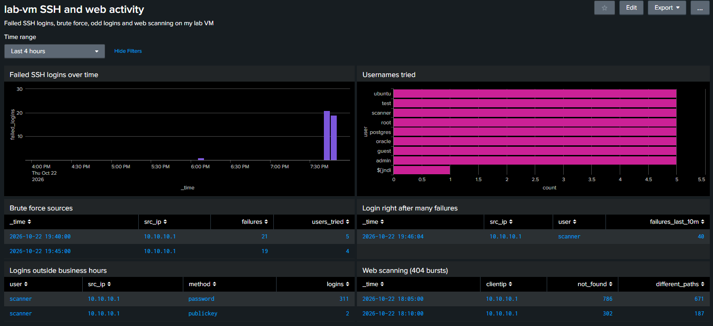

# splunk-detections

Splunk searches and a dashboard for catching SSH brute force and odd logins on my home lab VM (lab-vm, Ubuntu 22.04 running SSH and Apache). This is the detection side of my lab. The scanning and patching side is in [cve-triage](https://github.com/Meelaad/cve-triage).



## How I run Splunk
Splunk runs in Docker (the free trial image, version 10.6.1.1 when I did this). The admin password comes from the SPLUNK_PASSWORD environment variable so it's not in any file.

```
docker run -d --name splunk -p 8000:8000 \
  -e TZ=America/Toronto \
  -e SPLUNK_GENERAL_TERMS=--accept-sgt-current-at-splunk-com \
  -e SPLUNK_START_ARGS=--accept-license \
  -e SPLUNK_PASSWORD \
  -v "$(pwd)/../splunk-lab/logs:/var/log/lab:ro" \
  -v "$(pwd)/config:/opt/splunk/etc/apps/lab_inputs/local" \
  splunk/splunk:latest
```

The VM's /var/log/auth.log and /var/log/apache2/access.log get copied live into the logs folder with tail -F, and config/inputs.conf tells Splunk to read them. config/props.conf sets the timezone for auth.log, because its lines don't have one and Splunk would read them as UTC.

## What I tested
From my Kali box (10.10.10.1 on the lab network) I tried 40 SSH logins with wrong passwords for 8 usernames: root, admin, test, oracle, ubuntu, postgres, guest and the real scanner account. Then I logged in as scanner with an SSH key. Earlier that evening I had scanned the VM with Nessus, so the logs also have its SSH logins and a lot of web requests.

## Searches
- searches/ssh_brute_force.spl counts failed passwords per source IP in 5 minute windows and shows sources with 10 or more. It caught 21 and 19 failures from 10.10.10.1.
- searches/success_after_failures.spl finds a successful login from an IP that had 5 or more failures in the 10 minutes before it. My first version just counted failures and successes per IP, but that also matched the Nessus logins from before the attack. I changed it to use streamstats so the order matters, and now it only shows my key login with the 40 failures before it.
- searches/off_hours_logins.spl shows successful logins before 8am, after 6pm or on weekends. At first it also flagged 311 Nessus logins, because I ran the scan after 6pm. I added an allowlist for the scan, but not just for the scanner username. In my lab Nessus and my test login both used the scanner account from Kali, so leaving that user out hid my login too and the search returned nothing. Nessus logs in with a password and I used a key, so the search only skips scanner password logins from 10.10.10.1. Now it shows just my 2 key logins.
- searches/web_scan_404s.spl finds 50 or more 404s from one IP in 5 minutes. It caught the Nessus web checks: 786 and 302 not found responses across 671 and 187 different paths.

Something I didn't expect: one of the usernames in the dashboard is ${jndi. That came from Nessus. It sent a Log4Shell lookup string as the SSH username to see if anything on the server would run it.

## Dashboard
dashboard/lab_vm_activity.xml is the dashboard source (Edit, then Source in Splunk). It has a time picker and six panels built from the searches above.

## Sample logs
sample_logs has the sshd lines from the brute force test and 40 of the Nessus 404 lines from the Apache log, so you can see what the searches run on. The IPs are from my isolated lab network.
